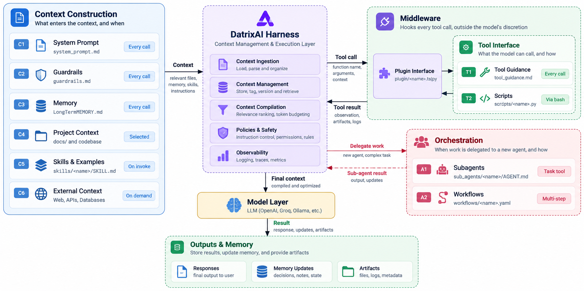

<p align="center">
  
</p>

<h1 align="center">DatrixAI</h1>

<p align="center">
  <strong>The context and harness layer for AI agents.</strong>
</p>

<p align="center">
  Build more reliable AI applications by managing context, memory, tools, policies, and orchestration around the model.
</p>

<p align="center">
  <a href="LICENSE"></a>
  
  
  
  
  
</p>

<!-- <p align="center">
  
  
  
  
  <a href="https://github.com/AtharvaThakare14/DatrixAI"></a>
  <a href="https://github.com/AtharvaThakare14/DatrixAI/stargazers"></a>
</p> -->

---

## What is DatrixAI?

Building an AI agent is about more than choosing a model and writing a prompt. Real applications need relevant project information, instructions, memory, tools, safety rules, and a way to coordinate multi-step work.

**DatrixAI is an open-source Python framework intended to provide that management layer around an AI model or coding agent.** It aims to make context construction, tool execution, memory, and orchestration more structured, reusable, and testable.

For example, when you ask an AI coding agent to understand a FastAPI project, fix a login bug, and explain the changes, DatrixAI is designed to help assemble relevant files and decisions, prepare the model's context, manage tool calls, and preserve useful outcomes.


## Why a context and harness layer?

As agent workflows grow, prompts, project files, tools, memories, and execution rules can become scattered across different systems. DatrixAI aims to bring these concerns into a reusable layer.

- **Context construction:** Assemble task-relevant instructions and information.
- **Context management:** Organize and retrieve project context instead of passing every available file to the model.
- **Memory:** Preserve selected decisions and useful information between tasks.
- **Policies and guardrails:** Provide a common place for configured restrictions and permission checks.
- **Tool execution:** Define tool interfaces and handle tool results.
- **Orchestration:** Coordinate multi-step workflows and, where configured, subagents.
- **Observability:** Make execution easier to inspect through logs and traces.
- **Model flexibility:** Keep the harness conceptually separate from a specific model provider.

## Architecture

DatrixAI sits between the developer's AI client and the model, tools, and information required to complete a task. The harness prepares context and manages execution; the LLM remains responsible for model-based reasoning.

<p align="center">
  
</p>

> **Asset note:** This README expects the architecture image to be saved as `assets/architecture.png`. If your actual PNG has a different filename, update the path above to match it.

### How the architecture works

1. **Developer / AI client** — A task arrives from an IDE, CLI, or compatible agent.
2. **DatrixAI harness** — Collects relevant context, manages memory, applies configured rules, and prepares information for the model.
3. **Model layer** — An LLM accessed through an API or running locally reasons about the task and decides what to do next.
4. **Middleware and tools** — Tool requests pass through the available interface. Middleware can apply configured checks, permissions, and logging before a tool runs.
5. **Orchestration** — Larger tasks can be divided among workflows or subagents when those capabilities are configured.
6. **Outputs and memory** — The result is returned to the client, and selected decisions, notes, or artifacts can be saved for future work.

Tool use may be iterative: the model requests a tool, receives its result, and reasons again before producing the final response.

### Core components

| Component | What it does | Example |
|---|---|---|
| **System prompt** | Defines the agent's primary instructions. | “You are a Python coding assistant.” |
| **Guardrails** | Describes rules and restrictions for execution. | “Never expose API keys.” |
| **Memory** | Makes selected past decisions available to later tasks. | “This project uses FastAPI and Supabase.” |
| **Project context** | Supplies relevant files and code details. | `auth.py`, `main.py`, and configuration. |
| **Skills and examples** | Provides reusable task-specific guidance. | How to write and test API endpoints. |
| **External context** | Supplies information from outside the codebase. | Documentation, APIs, or databases. |
| **Context compiler** | Prioritizes and assembles useful information within the model's context limit. | Include the five files relevant to a login bug rather than all 200 project files. |
| **Middleware and tool interface** | Routes tool calls and provides a place for checks and logging. | Read a file or run an allowed test. |
| **Orchestration** | Coordinates steps and optional specialist agents. | Analysis, implementation, and testing stages. |
| **Outputs and memory updates** | Returns results and preserves selected artifacts or decisions. | A change summary and a relevant authentication decision. |

### A complete example

Imagine asking DatrixAI to add a password-reset endpoint to an existing FastAPI application.

1. **Submit the task:** The request arrives from your IDE or CLI.
2. **Collect context:** Identify relevant authentication code, project instructions, and existing design decisions.
3. **Compile context:** Select the information most relevant to the task and prepare it for the model.
4. **Plan the change:** The model determines which files and tools may be needed.
5. **Use tools:** Requested file reads, edits, or tests are handled through the configured tool interface and policies.
6. **Coordinate work:** If orchestration is configured, analysis or testing work can be delegated to separate workflow steps or subagents.
7. **Return and preserve results:** The client receives the result and explanation; selected project decisions or artifacts may be saved for later tasks.

These steps describe the intended workflow, not a guarantee that every capability is already implemented in the current version.

## Design principles

- **Context is a first-class concern.** Make the information supplied to a model explicit and inspectable.
- **Small, composable components.** Keep pieces independently useful and easier to test.
- **Testability by design.** Test context handling, policies, tools, and workflows without requiring every test to call a live model.
- **Provider flexibility.** Avoid coupling the core harness to one model vendor wherever practical.
- **Controlled tool use.** Keep tool permissions and execution checks explicit.
- **Deliberate memory.** Save useful information selectively rather than storing every model response.
- **Incremental adoption.** Build a small, useful harness first and expand as requirements grow.

## Planned MVP

The initial milestone focuses on practical context and harness management.

- [ ] Structured context items with priorities and pinned instructions
- [ ] Context compilation and budget-aware selection
- [ ] Persistent, inspectable memory
- [ ] A minimal agent execution path
- [ ] Tool interfaces and configurable execution policies
- [ ] Workflow composition
- [ ] Logging and basic execution traces
- [ ] Unit tests for context handling and agent behavior
- [ ] Examples for connecting different model providers

This checklist is a roadmap, not a claim that all features are already available.

## Installation

Clone the repository and create a virtual environment:

```bash
git clone https://github.com/AtharvaThakare14/DatrixAI.git
cd DatrixAI

python -m venv .venv
```

Activate the environment.

**Windows PowerShell**

```powershell
.venv\Scripts\Activate.ps1
```

**macOS / Linux**

```bash
source .venv/bin/activate
```

Install dependencies:

```bash
pip install -r requirements.txt
```

If your configured model provider requires credentials, create a local environment file from the example:

```powershell
# Windows PowerShell
Copy-Item .env.example .env
```

```bash
# macOS / Linux
cp .env.example .env
```

Add only the credentials required by your setup. Never commit `.env` files or API keys.

## Running the application

The repository includes application entry points and deployment configuration. From the project root, try:

```bash
python main.py
```

For an API-based deployment, check `api/app.py`, `api/routes.py`, and the relevant deployment configuration to confirm the current entry point and required environment variables.

## Quick start

The public Python API is still evolving. Use the current source code and examples as the source of truth for runnable usage. The following is an **illustrative example of the intended interface**, not a guarantee that these imports are available in the current version:

```python
from datrixai import Agent

agent = Agent(
    instructions="You are a helpful research assistant.",
)

result = agent.run("Summarize the key ideas in retrieval-augmented generation.")
print(result)
```

Replace this example with a verified, runnable example once the public API is finalized.

## Testing

Run the tests from the repository root:

```bash
python -m pytest
```

If pytest is not installed:

```bash
pip install pytest
python -m pytest
```

When contributing, add tests for new behavior and prefer deterministic tests with mocked model and external-service calls where practical.

## Project structure

```text
DatrixAI/
├── .gitignore
├── .env.example
├── Dockerfile
├── LICENSE
├── Procfile
├── README.md
├── main.py
├── railway.json
├── requirements.txt
├── requirements-vercel.txt
├── runtime.txt
├── vercel.json
├── api/
│   ├── __init__.py
│   ├── app.py
│   └── routes.py
├── src/
│   ├── __init__.py
│   ├── agent.py
│   ├── config.py
│   ├── llm.py
│   ├── tools.py
│   └── utils.py
├── workflows/
│   ├── __init__.py
│   ├── content_workflow.py
│   └── pipeline.py
├── assets/
│   ├── datrixai-logo.png
│   └── architecture.png
├── tests/
│   └── test_agent.py
└── docs/
    └── architecture.md
```

Keep the filenames in this listing aligned with the actual repository. If your PNGs have different names, update both the image paths in this README and the names shown here.

## Deployment

DatrixAI contains configuration files for deployment platforms. Before deploying:

1. Confirm the application starts locally.
2. Configure provider credentials as environment variables on the hosting platform.
3. Keep secrets out of source control and logs.
4. Run tests before publishing.
5. Verify the deployed API and model/tool connectivity.

## Roadmap

- **Phase 1 — Context foundation:** Context items, prioritization, pinned instructions, compilation, and context-budget handling.
- **Phase 2 — Memory:** Persistent memory, retrieval, and inspectable memory operations.
- **Phase 3 — Agent harness:** Reusable instructions, tool interfaces, execution policies, and middleware.
- **Phase 4 — Workflows:** Compose steps and agents into testable workflows.
- **Phase 5 — Integrations:** Improve compatibility with external LLM providers and AI coding environments.
- **Phase 6 — Evaluation:** Add traces, repeatable tests, and evaluation workflows.

## Contributing

Contributions, bug reports, design discussions, and documentation improvements are welcome.

1. Open an issue to discuss substantial changes.
2. Create a focused branch for your work.
3. Add or update tests for behavior changes.
4. Run the test suite before opening a pull request.
5. Explain the motivation and trade-offs in your pull request.

Keep contributions modular, and avoid adding provider-specific behavior to core abstractions unless it is necessary.

## License

DatrixAI is distributed under the license included in the [`LICENSE`](LICENSE) file. Review that file for the applicable terms.

## Acknowledgements

DatrixAI is inspired by open-source work on AI agents, context engineering, and agent harness design. It is an independent project and is not affiliated with or endorsed by other projects referenced for inspiration.
